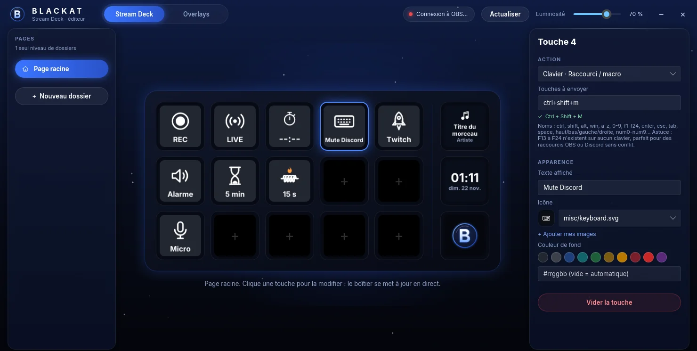

# Blackat Stream Deck

Logiciel léger et fait maison pour le **Stream Deck SOOMFON 15 touches** (Windows 10/11).
Il remplace l'appli officielle : OBS, musique, Streamer.bot, raccourcis clavier, soundboard,
compte à rebours… sans ralentir le jeu ni le live (≈ 9 Mo de RAM et ≈ 0 % de CPU au repos).

**Site de présentation :** https://black-at.github.io/blackat-stream-deck/
**Télécharger :** page *Releases* du dépôt → `Soomfon-Deck-<version>.msi`.



## Ce qu'il y a dedans

| Programme | Rôle |
|---|---|
| `soomfon-deck.exe` | Pilote du boîtier, tourne en arrière-plan sans fenêtre |
| `soomfon-editor.exe` | Éditeur : touches, icônes, couleurs, écran latéral, overlays |
| `blackat-launcher.exe` | Lance OBS, Streamer.bot et le Stream Deck en un clic ; sauvegarde la config |

## Actions possibles sur une touche

- **OBS** : changer de scène, REC, pause REC, live, jouer un média, couper un son, afficher/masquer une source, replay, chrono du live, dossier automatique des scènes
- **Musique** : lecture/pause, pistes, volume Windows (pilote le lecteur qui joue, Spotify en priorité)
- **Streamer.bot** : lancer une action par son nom
- **Raccourci clavier / macro** : `ctrl+shift+m`, ou une suite `ctrl+c, ctrl+v` (F13 à F24 acceptées)
- **Lancer** : programme, fichier, dossier ou site web
- **Soundboard** : mp3, wav, ogg, m4a… avec volume par touche ; nouvel appui = stop
- **Compte à rebours** : anneau + temps restant sur la touche, « FINI » et un son à la fin
- **Coil** : pause imposée entre deux taffes
- **Dossiers** (un niveau), touches décoratives

La configuration est dans `%APPDATA%\soomfon-deck\config.toml` (écrite par l'éditeur, lisible à la main).

## Compiler

Rust (toolchain MSVC) puis :

```
cargo build --release --workspace
cargo test --workspace
python installer/make-msi.py --wix C:\dev\tools\wix314
```

Détails : [docs/INSTALLEUR.md](docs/INSTALLEUR.md), matériel : [docs/MATERIEL.md](docs/MATERIEL.md),
décisions : [docs/CAHIER-DES-CHARGES.md](docs/CAHIER-DES-CHARGES.md).

## Crédits

Police [Inter](https://rsms.me/inter/) (licence SIL OFL 1.1, `resources/fonts/OFL-Inter.txt`).
Projet personnel, non affilié à SOOMFON.
