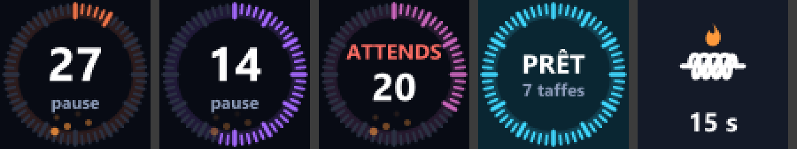

# Coil sur le Stream Deck

Version Stream Deck de l'appli iPhone Coil : pause imposée entre deux taffes pour que le coton se ré-imbibe et que la résistance dure.

*De gauche à droite : juste après une taffe (chaud, braises), mi-pause, appui pendant la pause, pause finie, touche au repos.*

## Utilisation

- **Touche « Coil · Pause entre deux taffes »** (éditeur → Action), durée au choix : 10, 15, 20, 30, 45, 60 ou 90 s. On peut en mettre plusieurs (ex. une 15 s et une 30 s).
- Un appui = « j'ai tiré » : la pause démarre, la touche affiche le cadran et le compte à rebours.
- Appui pendant la pause : « ATTENDS » (la pause n'est pas relancée, la taffe n'est pas recomptée).
- Fin de la pause : son de notification de Windows, « PRÊT » en surbrillance.
- **Écran de droite** : case « Coil (pause vape) » = même cadran, et au repos « PRÊT » + nombre de taffes du jour.

## Style repris de l'appli

Cadran de 60 graduations qui s'allument au fil de la pause, couleur de la résistance qui refroidit (orange → violet → cyan), braises quand elle est chaude, fond sombre. Le Liquid Glass d'iOS n'existe pas sur des écrans 85×85 en JPEG : les effets sont redessinés.

## Technique

- `src/coil.rs` : état, compteur du jour dans `%APPDATA%\soomfon-deck\coil.json` (remis à zéro chaque jour).
- `visuals::coil_visual` : rendu partagé touche / écran latéral ; `render::Dial` : cadran.
- Battement 1 Hz seulement pendant une pause (et 4 s après pour « PRÊT »).
